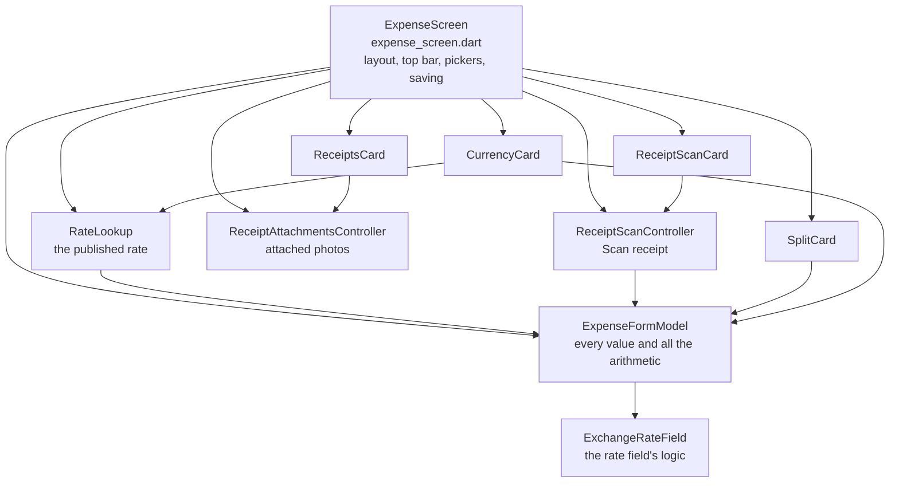

# The expense screen's code

A map of the add/edit expense screen's code: the app's most complex screen. Written 2026-10-11 at `bd1c03a`, after [#289](https://github.com/sharneng/spliit2go/issues/289) split it into smaller parts ([#292](https://github.com/sharneng/spliit2go/issues/292)). Update it when files or responsibilities move. Why the form looks and behaves as it does is in [decisions/expense-form-restyle.md](decisions/expense-form-restyle.md); the code wins if the two disagree.

## Three layers

1. **The screen** (`lib/screens/expense_screen.dart`) owns the page and the objects below, lays the cards out, opens pickers and dialogs, and saves.
2. **The model** (`ExpenseFormModel`) holds every field's value and works out amounts, shares and what's wrong. It draws nothing, holds no focus and no `BuildContext`, so it's unit-tested without widgets.
3. **The cards** (`lib/screens/expense_form/`) each draw one part of the form from the model and change it. Logic that isn't drawing has its own controller: the rate's, the lookup's and the scan's.

A key typed goes into one of the model's controllers; a tap calls one of its setters. Either way the model notifies, and the cards rebuild. On ✓ the screen asks the model for the amounts and the split, and saves.

## The screen: `expense_screen.dart`

**`ExpenseScreen`** (`StatefulWidget`) is what other screens open. It takes:

- `client`, `db`, `outbox`, `group`, `activeUserId`.
- `existingExpense` to edit one. Editing is online only and saves straight to the server.
- `initialDraft` to start a new one filled in: Balances' "Mark as paid" opens a settlement this way.
- `receiptPicker`, `receiptScanner`, `prepareReceipt`, `openSettings`: the platform's, or fakes in tests.

**`_ExpenseScreenState`** owns:

| Field | Type | What for |
|---|---|---|
| `_m` | `ExpenseFormModel` | Every value in the form |
| `_receipts` | `ReceiptAttachmentsController` | Attached photos and their uploads |
| `_scan` | `ReceiptScanController` | Scan receipt: its status, language, and what it filled in |
| `_rates` | `RateLookup` | Looking up the published rate |
| `_formKey`, `_scroll` | `GlobalKey<FormState>`, `ScrollController` | Validation, and scrolling to what's wrong |
| `_categories` | `List<Category>` | Spliit's seeded list until the server's is read |
| `_saving`, `_saveError` | | ✓'s spinner, and an error above the cards |

Its functions, by job:

- **Starting:** `_start` makes the model with the locale's decimal separator; `_loadCategories`; `_loadDefaultSplit` reads the group's remembered split (`db.defaultSplitFor`).
- **Layout:** `build` → `_form`: the top bar, then, top to bottom, the scan card (`_scanSection`), the title/category/date/repeat card (`_repeatRow`), `CurrencyCard`, `SplitCard` with `_paidByRow` as its first row, `ReceiptsCard`, notes.
- **Top bar:** `_title`; `_kindButton` and `_switchKind` switch Expense ↔ Settlement, asking first for a saved one (`_converts`); `_confirmLeave` asks before ✕ drops changes.
- **Pickers:** `_pickDate`, `_pickCategory`, `_pickPaidIn`, `_pickReceiptLanguage`; Paid by opens `showParticipantSheet` from `_paidByRow`.
- **Receipts:** `_addReceipt`, `_scanReceipt`, `_photoFailed`.
- **Saving:** `_save` checks the form and the receipts, then:
  - `_saveNew`: a new expense goes into the database as a pending row (`db.insertPending`), so it shows straight away and works offline. When the screen closes, the screen that opened it (the group screen, Balances) syncs, and the `Outbox` sends it.
  - `_saveEdit`: an edit goes to the server (`client.updateExpense`).
  - `_refuse` shows what's wrong, scrolls to it, and announces it when the form's own announcement doesn't (#263); `_rememberDefaultSplitIfRequested` saves the default split (`db.setDefaultSplit`); `_activityParticipant` credits the change to the active user.

## The model: `expense_form/expense_form_model.dart`

**`ExpenseFormModel`** (`ChangeNotifier`), made from the group, the expense being edited or a draft, the active user (a new expense's Paid by, `resolveDefaultPaidBy`) and the decimal separator.

- **Text controllers:** `titleController`, `amountController`, `originalAmountController` (the amount in the paid-in currency), `notesController`, and `splitControllers`, one per person.
- **Values and setters:** `paidBy`, `date`/`setDate`, `category`/`setCategory`, `isSettlement`/`setSettlement`, `splitMode`, `recurrenceRule`, `saveDefaultSplit`; who's included with `isIncluded`, `setIncluded`, `toggleSelectAll`; `applyDefaultSplit`.
- **Currency:** `paidIn`, `choosePaidIn`, `converting`, `paidInCurrency`; the rate is `rateField` (an `ExchangeRateField`) and `rate`.
- **Amounts:** `amount`, `typedAmount`, `originalAmount`, `settlementTotal`; `amountsToSave()` returns an `ExpenseAmounts`.
- **The split:**
  - `typedValue` and `percentageBasisPoints` read one person's value.
  - `unallocated()` is the running "still to allocate"/"over": a `double` in currency units for Amount (a 3-cent remainder is `0.03`) and in percentage points for Percent (one basis point is `0.01`); positive is still to allocate, negative over, null for Evenly, Shares and a settlement. Inside, it sums whole minor units and basis points and converts the result, so amounts that add up give exactly 0.
  - `showsLivePreview` and `livePreviewAmounts()` give each person's amount as it's typed.
  - `splitProblem()` returns a `SplitProblem`: `NoOneIncluded`, `InvalidValue`, `PercentagesDontAddUp` or `AmountsDontAddUp`.
  - `paidFor()` is the list that's saved.
- **Changes:** `hasChanges`, `markUnchanged`, `hasChangesBeyondKind` (for ✕ and the kind button).
- **Editing:** `_prefillFrom` fills the form from a saved expense.

## The cards and their helpers: `expense_form/`

| File | Contains | Does |
|---|---|---|
| `split_card.dart` | `SplitCard` | Paid by and Paid for, or a settlement's From and To. The mode pill, or a menu row where it doesn't fit (`_modes`); a row per person (`_row`); a settlement's totals; and the message under it (`_hint`, and `problem`, which `_refuse` also announces) |
| `currency_card.dart` | `CurrencyCard`, `_RateField` | Paid in, the amount, the rate row with its pair to swap, the rate's note (`_rateStatus`), and the "In {currency}" rows |
| `rate_field.dart` | `ExchangeRateField` | The rate field's logic: which currency is first in the pair (`swap`), filling in a looked-up rate without overwriting a typed one (`fill`, `typed`), a saved rate when editing (`showSaved`) |
| `rate_lookup.dart` | `RateLookup`, `RateLookupState` | Looks up the published rate (`lookUp`) and remembers the pair's order on this device (`swap`, `loadOrder`) |
| `receipt_scan_controller.dart` | `ReceiptScanController`, `ReceiptScanStatus` | Reads a receipt into the form (`read`), its language (`loadLanguage`, `pickLanguage`), and takes a fill back when reading again |
| `receipt_scan_card.dart` | `ReceiptScanCard` | The scan button, language and status |
| `inline_number_field.dart` | `InlineNumberField` | A number field inside a row, with its symbol or %: the amount and each person's value. Given a `label` or a `row` builder, the whole row is one screen-reader element and a tap anywhere on it types into it (#263) |
| `form_text.dart` | helpers, `RetypeAssist`, `Overhang` | The rows' label and value styles (`formLabel`, `formValueStyle`), `formFieldRow`, `workedOutRow`, `compactTextButtonStyle`; screen-reader names (`namedField`, `unreadHint`, #288); `RetypeAssist`: select-all on Android, ⓧ on iPhone; `Overhang`: a tap target bigger than the space it takes ("Use the published rate") |

## Shared code it uses

**Widgets, `lib/widgets/`**

| File | Used for |
|---|---|
| `grouped_section.dart` | `GroupedSection` (a card), `GroupedRow`, `GroupedCaption`, `GroupedDivider`, `GroupedScrollClip`: every card and row |
| `participant_sheet.dart` | `showParticipantSheet`, `ChoiceRow`, `participantName`: Paid by and From; "Who are you?" shares the rows |
| `group_monogram.dart`, `participant_colors.dart` | `Monogram` and `participantColors`: each person's initials and color |
| `segmented_pill.dart` | `SegmentedPill`: Evenly / Shares / Percent / Amount, and `fits`, whether its names fit |
| `label_and_value.dart` | `LabelAndValue`: a label and its value on a line, or the value under it at the line's end when they don't fit (#263, #294) |
| `line_or_stack.dart` | `LineOrStack`: Scan receipt's icon, text and language on a line, or on two centered lines (#294) |
| `text_scaled.dart`, `flag_glyph.dart` | `context.textScaled`, `FlagGlyph`: glyphs that grow with the text by its square root (#294) |
| `money.dart` | `Money`: an amount, formatted |
| `currency_picker.dart` | `pickCurrency`, `searchSheetHeight` (Group settings uses it too) |
| `category_picker.dart`, `category_icon.dart` | `showCategoryPicker`, `CategoryIconGlyph` |
| `receipt_attachments.dart` | `ReceiptAttachmentsController`, `ReceiptsCard`, `chooseReceiptSource` |
| `receipt_language.dart` | `showReceiptLanguagePicker` |
| `confirm_dialog.dart` | `showConfirmDialog`: every alert (#276) |
| `error_message.dart` | `ErrorMessage`, `showErrorSnackBar` |
| `top_bar_buttons.dart`, `app_menu.dart`, `bottom_inset.dart` | ✕/✓ (`TopBarButtons`), the Repeat and split menus (`MenuRow`), `AboveBottomBar` (#283) |

**Services, models and utilities**

| Area | Files and what's used |
|---|---|
| Data and sync | `api/spliit_client.dart` (`SpliitClient.updateExpense`), `db/app_database.dart` (`AppDatabase`: `insertPending` for a new expense, `defaultSplitFor` and `setDefaultSplit` for the group's remembered split, `groupRow` for the active user), `sync/outbox.dart` (`Outbox`) |
| Rates | `services/exchange_rates.dart` (`ExchangeRates.of(db)`, `ExchangeRate`, `NoPublishedRate`, `RatesUnavailable`, `ranking`), `models/currency_ranking.dart` |
| Shares | `services/expense_shares.dart` (`shareCentsFor`): the same rounding for the live preview and what's saved |
| Receipts | `services/receipt_scanner.dart` (`ReceiptScanner`, `ReceiptScript`), `receipt_fill.dart` (`receiptFill`), `receipt_photo.dart` (`prepareReceiptPhoto`), `receipt_text.dart`, `receipt_cache.dart` |
| People and categories | `services/active_user.dart` (`resolveDefaultPaidBy`, `activityParticipantId`), `services/category_store.dart` (`CategoryStore`) |
| Settings | `services/settings_service.dart`: the receipt language (`receiptScript`, `setReceiptScript`) and each pair's order (`rateBase`, `setRateBase`) |
| Models | `models/expense.dart` (`Expense`, `ExpenseShare`, `SplitMode`), `group.dart` (`Group`, `Participant`), `currency.dart` (`Currency`, `currencyByCode`), `category.dart`, `default_split.dart` |
| Utilities | `utils/money.dart` (`formatMoney`, `toMinorUnits`, `fromMinorUnits`, `convertToGroupAmount`), `decimal_input.dart`, `date_format.dart`, `haptics.dart` |
| Translation | `l10n/context_l10n.dart` (`context.l10n`), `category_names.dart`, `currency_names.dart` |

## Tests

- `test/screens/expense_form/expense_form_model_test.dart`: the model, without widgets.
- `test/screens/expense_form/expense_form_frame_test.dart`: the top bar, the cards' layout, the kind button, the keyboard.
- `test/screens/expense_form/people_card_test.dart`: Paid by and Paid for, and what a screen reader hears.
- `test/screens/expense_form/expense_form_a11y_test.dart`: tap targets and screen-reader labels on both platforms, large text, and what a refused save announces (#263).
- `test/screens/expense_screen_test.dart`: whole flows: saving, editing, currencies and rates, settlements.
- `test/screens/expense_receipt_scan_test.dart`, `expense_receipts_form_test.dart`, `expense_receipts_test.dart`: scanning and attaching receipts.
