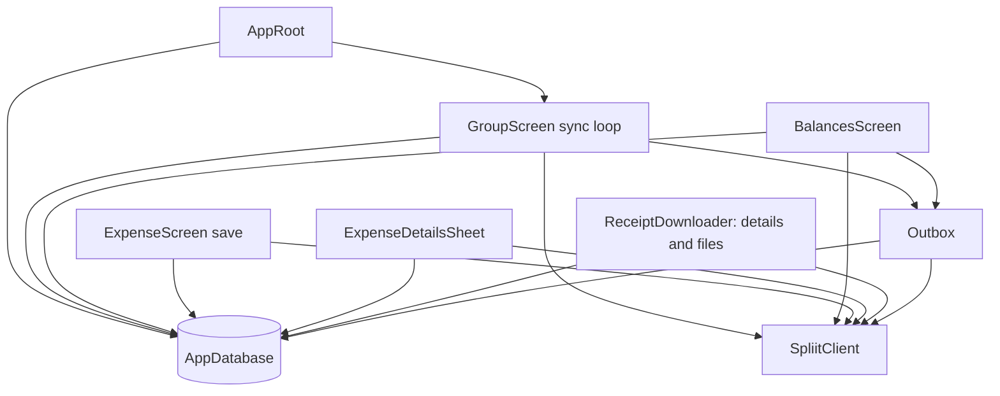

# Spliit2Go architecture review — October 14, 2026

Reviewed by Ezra at [`bdea603c868f0a46988735fbe787cac050d5bf10`](https://github.com/sharneng/spliit2go/commit/bdea603c868f0a46988735fbe787cac050d5bf10), after fetching GitHub and fast-forwarding local `main` with `git pull --ff-only origin main`. This is 56 commits after the first review's `062deeb`. Review branch: `codex/architecture-review-2026-10-14`.

This pass reviews architecture after the UI work: form state and calculations, async controllers, navigation/lifecycle, persistence, sync, cached details, exchange rates, rendering, native boundaries, and test structure. It rechecks the [October 9 snapshot](https://github.com/sharneng/spliit2go/blob/b3f65a0959136bb06f2f0977b320cd3c64328955/docs/reviews/2026-10-09-repository-review.md). It does not repeat the earlier file-by-file Markdown audit. No application fixes are included.

## Assessment

**The UI restructuring is a useful improvement. The next substantial architecture work should address data identity, cache coherence and sync guarantees, rather than another UI rewrite.**

ExpenseScreen now delegates calculations/state to ExpenseFormModel, exchange lookup to RateLookup, rate editing to ExchangeRateField, and receipt interpretation to ReceiptScanController. Cards provide recognizable presentation boundaries. Controllers are explicitly disposed, stale rate responses are ignored, money helpers now take the currency's decimal places, and the new code map explains responsibilities. These are worth keeping.

The new group refresh loop also improves startup/resume/manual-refresh behavior and coalesces overlapping triggers **within one screen instance**. However, several screens and background services still write the same cache independently. That boundary remains the principal source of correctness risk. Cached summary fields and full-detail fields can come from different server revisions, and their local write paths do not enforce a common freshness rule.

Eight actionable findings follow. P1 = address before relying on the affected financial/routing behavior; P2 = normal corrective work. Longer-term restructuring is listed separately, with no framework migration proposed.

## Validation and limits

- `scripts/run_test`: build_runner, gen-l10n, analysis and **1,370 tests passed**. Line coverage **76.5%**: 9,785 of 12,798 lines, across 105 files in the coverage report.
- `flutter build ios --simulator --debug --flavor dev`: **passed**, producing `build/ios/iphonesimulator/Runner.app`. This checks native compilation and flavor integration; it does not verify camera, clipboard prompts, accessibility or gesture behavior on a physical device.
- Reviewed SDK: Flutter **3.47.6** stable, Dart **3.13.5**.
- **Eight focused characterization tests passed**, confirming the defective behavior in A1–A8. The first five are the October 9 reproductions, run again unchanged against this revision; three additional tests cover full-detail writes, delayed defaults and Markdown images.
- The evidence is [architecture_20261014_reproductions_test.dart](architecture_20261014_reproductions_test.dart). These tests deliberately assert the current defects. They stay outside `test/` so normal CI does not require bugs to remain. They should be converted into tests of correct behavior when fixes are implemented.
- The stale-response/default tests explicitly arrange completion ordering at the model/database boundary. They establish missing invariants; they do not measure how frequently a race occurs on a device. The Markdown test preloads a pixel into Flutter's image cache to avoid actual HTTP, then verifies that rendering creates a NetworkImage without any tap. Dependency source confirms the network behavior on a cache miss.
- No production group writes, new Android build, physical-device pass, PR review submission, or scheduled follow-up was performed. Android build configuration and CI were inspected. This report and its reproduction file are the only repository changes from this pass.

Run the reproductions from the repository root:

```sh
TZ=America/Los_Angeles flutter test docs/reviews/architecture_20261014_reproductions_test.dart
```

## Findings

### A1 — P1: Remote IDs are still treated as globally unique across servers

References: [lib/db/app_database.dart:106](https://github.com/sharneng/spliit2go/blob/bdea603c868f0a46988735fbe787cac050d5bf10/lib/db/app_database.dart#L106), [lib/db/app_database.dart:305](https://github.com/sharneng/spliit2go/blob/bdea603c868f0a46988735fbe787cac050d5bf10/lib/db/app_database.dart#L305), [lib/screens/join_group_screen.dart:253](https://github.com/sharneng/spliit2go/blob/bdea603c868f0a46988735fbe787cac050d5bf10/lib/screens/join_group_screen.dart#L253), [lib/sync/outbox.dart:95](https://github.com/sharneng/spliit2go/blob/bdea603c868f0a46988735fbe787cac050d5bf10/lib/sync/outbox.dart#L95). Previous finding: **F1, still present**.

Groups and expenses are keyed by remote ID alone. Joining the same group ID from server B upserts the row for server A and changes its remembered server. Pending expenses remain, so the next outbox built from B's URL sends A's pending payload to B. Restored or cloned self-hosted instances are a realistic way to encounter shared IDs; this does not depend on guessing a random ID collision. Expense-ID collisions also affect references and cache writes.

The reproduction still produces one joined row after joining A and B, and observes an A expense POSTed to B through the production join/outbox paths, with fake HTTP.

**Change:** introduce a local joined-group identity, unique on `(canonical server URL, remote group ID)`. Scope remote expense IDs and local references by that identity. Carry the local key through active participant, default split, receipt language, outbox queues, navigation and downloader status. Preserve pending rows during migration. Categories already use server-scoped keys and provide a useful precedent.

This is a storage invariant, not something the redesigned group rows or a per-screen Outbox constructor can enforce.

### A2 — P1: A committed create with a lost response can be created again

References: [lib/sync/outbox.dart:95](https://github.com/sharneng/spliit2go/blob/bdea603c868f0a46988735fbe787cac050d5bf10/lib/sync/outbox.dart#L95), [lib/sync/outbox.dart:124](https://github.com/sharneng/spliit2go/blob/bdea603c868f0a46988735fbe787cac050d5bf10/lib/sync/outbox.dart#L124), [lib/sync/outbox.dart:156](https://github.com/sharneng/spliit2go/blob/bdea603c868f0a46988735fbe787cac050d5bf10/lib/sync/outbox.dart#L156), [lib/api/spliit_client.dart:491](https://github.com/sharneng/spliit2go/blob/bdea603c868f0a46988735fbe787cac050d5bf10/lib/api/spliit_client.dart#L491). Previous finding: **F3, still present**.

The server allocates a create ID, then the app acknowledges it locally. If the server commits and the response is lost, the row stays pending and the next flush submits another create. An app exit or local write failure between remote commit and acknowledgement has the same uncertainty. Per-group flush serialization prevents simultaneous submission of a pending row; it does not deduplicate retries after an unknown result.

The reproduction again records two accepted creates from two flushes after losing the first response. The recent change that preserves retry count for connection failures is sensible for genuinely offline work, but makes distinguishing an unknown create outcome more important: those failures no longer consume the automatic retry limit.

**Change:** persist operation identity and an explicit uncertain-outcome state. Prefer an upstream-supported idempotency key. Without that support, define reconciliation/user verification before automatically repeating an ambiguous create; matching expense contents is insufficient proof, because two identical purchases can be legitimate. Keep definite validation rejection, definitely-unsent work, and unknown remote commit separate. Apply the same reasoning to group creation. Do not describe retry serialization as exactly-once delivery.

### A3 — P1: Create acknowledgement does not invalidate older list snapshots

References: [lib/db/app_database.dart:697](https://github.com/sharneng/spliit2go/blob/bdea603c868f0a46988735fbe787cac050d5bf10/lib/db/app_database.dart#L697), [lib/db/app_database.dart:844](https://github.com/sharneng/spliit2go/blob/bdea603c868f0a46988735fbe787cac050d5bf10/lib/db/app_database.dart#L844), [lib/db/app_database.dart:863](https://github.com/sharneng/spliit2go/blob/bdea603c868f0a46988735fbe787cac050d5bf10/lib/db/app_database.dart#L863), [lib/screens/group_screen.dart:300](https://github.com/sharneng/spliit2go/blob/bdea603c868f0a46988735fbe787cac050d5bf10/lib/screens/group_screen.dart#L300), [lib/screens/balances_screen.dart:138](https://github.com/sharneng/spliit2go/blob/bdea603c868f0a46988735fbe787cac050d5bf10/lib/screens/balances_screen.dart#L138). Previous finding: **F2, reduced exposure but still present**.

`markSynced` still does not bump the expense generation. A list snapshot obtained before a create commits can therefore be accepted after the pending row becomes non-pending, deleting the just-synced row from the local cache. Receipt references may be pruned too. The server still holds the expense, but offline views/balances become wrong until another successful fetch.

The database reproduction still accepts an empty pre-create snapshot and removes the acknowledged row. The new GroupScreen sync loop materially reduces the original same-screen interleaving. It does not establish a per-group invariant: BalancesScreen still performs its own flush/list replacement, and separate GroupScreen instances have separate `_syncRun` fields. GroupScreen's snapshot guard cannot protect those other writers.

**Change:** advance the mutation generation on successful create acknowledgement, including the no-parsed-server-ID path. Put list fetching, acknowledgement and snapshot acceptance behind one coordinator per local joined-group key. All entry points, including settlement and deep-link routes, should use it. Keep the existing edit/delete protection and add delayed-create/list interleaving tests. A SQLite watch stream updates presentation; it does not order network results.

### A4 — P2: Delayed full-detail responses can overwrite newer cached data

References: [lib/db/app_database.dart:980](https://github.com/sharneng/spliit2go/blob/bdea603c868f0a46988735fbe787cac050d5bf10/lib/db/app_database.dart#L980), [lib/services/receipt_downloader.dart:370](https://github.com/sharneng/spliit2go/blob/bdea603c868f0a46988735fbe787cac050d5bf10/lib/services/receipt_downloader.dart#L370), [lib/screens/expense_details_sheet.dart:413](https://github.com/sharneng/spliit2go/blob/bdea603c868f0a46988735fbe787cac050d5bf10/lib/screens/expense_details_sheet.dart#L413), [lib/screens/expense_screen.dart:1146](https://github.com/sharneng/spliit2go/blob/bdea603c868f0a46988735fbe787cac050d5bf10/lib/screens/expense_screen.dart#L1146). **New boundary introduced by cached full details.**

Background favorite downloads and open detail sheets independently fetch a complete expense and call `cacheExpenseDetails`. That method has no request generation/version check. It overwrites notes, conversion rate, document count and document references, then marks details as freshly fetched. An older response completing after an edit/newer refresh can replace newer data and make the old receipt list look authoritative.

The reproduction applies a newer summary with title “Edited” and two receipts after a mutation, then completes an old full response. The row ends with the new title, old note and a receipt count reduced to one, with a new `detailsFetchedAt`. This is a composite of two server snapshots. Updating document references can also remove files from the kept-reference set.

There is a related write gap: `_saveEdit` acknowledges the server and caches documents, but does not write the submitted notes/rate/core values back as one coherent expense. If the subsequent read fails, especially when a favorite retains previously known details, the local copy can keep the previous values despite a successful edit.

**Change:** treat summary/detail reads and mutation acknowledgements as repository operations with explicit freshness/field-presence semantics. Capture a local mutation generation before full reads, reject results invalidated by a local edit/delete, and order competing reads. Store the successful edit's submitted snapshot locally, in one transaction, instead of depending on another network read to repair it. Preserve a distinction between unknown details and known empty notes; a default empty field in a list DTO is not evidence that a note was deleted.

Local generations prevent this device's stale writes; they do not provide upstream edit-conflict prevention or an upstream server version that does not exist.

### A5 — P2: Calendar dates still change meaning after a timezone change

References: [lib/db/app_database.dart:38](https://github.com/sharneng/spliit2go/blob/bdea603c868f0a46988735fbe787cac050d5bf10/lib/db/app_database.dart#L38), [lib/db/app_database.dart:1217](https://github.com/sharneng/spliit2go/blob/bdea603c868f0a46988735fbe787cac050d5bf10/lib/db/app_database.dart#L1217), [lib/services/date_only.dart:42](https://github.com/sharneng/spliit2go/blob/bdea603c868f0a46988735fbe787cac050d5bf10/lib/services/date_only.dart#L42), [lib/services/exchange_rates.dart:151](https://github.com/sharneng/spliit2go/blob/bdea603c868f0a46988735fbe787cac050d5bf10/lib/services/exchange_rates.dart#L151). Previous finding: **F4, still present**.

API date-only conversion is correct, but expense dates are then persisted as epoch-backed DateTimes. A date chosen at New York midnight reads as the previous calendar day in Los Angeles. Cached dates can display differently after travel, and a pending expense can send the changed date when it finally syncs.

The reproduction persists the exact epoch of October 9 New York midnight and reads it in a Los Angeles test process; the day is October 8. It simulates the persisted epoch across timezone contexts, rather than changing a live device's timezone.

**Change:** represent an expense's calendar date explicitly, with a timezone-independent SQLite encoding such as `YYYY-MM-DD`. The new exchange-rate cache already uses day strings, a useful local precedent. Keep activity/creation/refreshed timestamps as instants. Plan recovery of existing rows: remote-backed dates can be refreshed, but the old epoch does not preserve the original timezone needed to recover every pending date perfectly.

### A6 — P2: Markdown rendering adds automatic external image requests

References: [lib/widgets/notes_text.dart:86](https://github.com/sharneng/spliit2go/blob/bdea603c868f0a46988735fbe787cac050d5bf10/lib/widgets/notes_text.dart#L86), [lib/utils/markdown_note.dart:1](https://github.com/sharneng/spliit2go/blob/bdea603c868f0a46988735fbe787cac050d5bf10/lib/utils/markdown_note.dart#L1), [docs/decisions/notes.md:15](https://github.com/sharneng/spliit2go/blob/bdea603c868f0a46988735fbe787cac050d5bf10/docs/decisions/notes.md#L15), [docs/privacy.md:7](https://github.com/sharneng/spliit2go/blob/bdea603c868f0a46988735fbe787cac050d5bf10/docs/privacy.md#L7). **New rendering/network boundary.**

NotesText passes group-provided Markdown directly to MarkdownBody without an image policy. In the installed `flutter_markdown_plus` 1.0.12, `lib/src/builder.dart` uses its default image builder when none is supplied; `lib/src/_functions_io.dart` constructs Image.network for HTTP(S) images. Opening a marked note containing `` therefore contacts that host on a cache miss without tapping a link. The form preview does the same.

The widget reproduction confirms construction of an external NetworkImage merely by rendering the note. Its pixel is pre-cached in the test, so no request actually leaves the test process. This behavior bypasses the app's explicit API/receipt/rate services, their cache policies and their error classification. It also introduces an additional network destination beyond the Spliit storage and Frankfurter destinations described by the privacy policy. The marker is controlled by the note's author; it is not reader permission to contact arbitrary hosts.

**Change:** define the supported Markdown subset and an explicit image/URL policy. A small default is to render image alt text or a load/open action and fetch only after the reader requests it. If remote images are intentionally supported automatically, route them through an explicit service with scheme, network, caching and error policies, and update the product/privacy description. Keep the selectable text/link behavior. Audit allowed link schemes separately rather than accepting every URI merely because it has a scheme.

### A7 — P2: A delayed default split overwrites edits already made in the form

References: [lib/screens/expense_screen.dart:328](https://github.com/sharneng/spliit2go/blob/bdea603c868f0a46988735fbe787cac050d5bf10/lib/screens/expense_screen.dart#L328), [lib/screens/expense_form/expense_form_model.dart:587](https://github.com/sharneng/spliit2go/blob/bdea603c868f0a46988735fbe787cac050d5bf10/lib/screens/expense_form/expense_form_model.dart#L587). **Current async initialization boundary.**

The form is usable before `defaultSplitFor` finishes. Its completion calls `applyDefaultSplit` unconditionally. The model computes `unchanged = !hasChanges`, but only uses it to decide whether to reset the dirty baseline; it still replaces the selected split mode, inclusion and values when the user has already changed them.

The reproduction enters an amount split of 9/1, then completes a remembered “Alice only, evenly” default. The chosen 9/1 split is replaced by a one-person split. Database latency determines exposure; the test arranges completion ordering directly rather than measuring device frequency.

**Change:** capture a split-edit revision before the async read and apply the result only if that revision is unchanged, or pass the default into model construction after loading it. Do not use whole-form dirty state alone: typing a title should not necessarily prevent a default from filling an untouched split, while any split/kind change should. The rate lookup's request/edit counters demonstrate the right pattern already present in this feature.

### A8 — P2: Core API requests are unbounded and pagination can repeat forever

References: [lib/api/spliit_client.dart:149](https://github.com/sharneng/spliit2go/blob/bdea603c868f0a46988735fbe787cac050d5bf10/lib/api/spliit_client.dart#L149), [lib/api/spliit_client.dart:187](https://github.com/sharneng/spliit2go/blob/bdea603c868f0a46988735fbe787cac050d5bf10/lib/api/spliit_client.dart#L187), [lib/api/spliit_client.dart:544](https://github.com/sharneng/spliit2go/blob/bdea603c868f0a46988735fbe787cac050d5bf10/lib/api/spliit_client.dart#L544), [lib/services/exchange_rates.dart:313](https://github.com/sharneng/spliit2go/blob/bdea603c868f0a46988735fbe787cac050d5bf10/lib/services/exchange_rates.dart#L313). Previous finding: **F6, still present**.

Increasing expense pages to 100 is a useful reduction in round trips. It does not stop a server returning `hasMore: true` with a missing/repeated cursor: the client repeats the first or current page and keeps allocating results. The repeated-cursor reproduction still sends identical requests until the fake server deliberately stops it.

Most core tRPC operations still lack application deadlines. One hanging create blocks the serialized group outbox and the screen's new `_syncRun`, so further refresh/reconnect triggers cannot recover it. Exchange rates, receipt PUTs and receipt downloads have deadlines already, but the common API transport does not.

**Change:** define bounded transport operations, cancellation ownership and error conversion in one place. Reject missing/visited opaque cursors when more pages are claimed; do not assume every deployment uses numeric cursors. Tie mutation timeout handling to A2's uncertain-outcome state, rather than interpreting timeout as proof no create occurred.

## What changed since the previous review

| Earlier finding/recommendation | Current status |
|---|---|
| F1: server-scoped identity | Still reproduced, A1. |
| F2: stale snapshot after create | Still reproduced at the database boundary, A3. Single-screen exposure is reduced by the new loop, but independent writers remain. |
| F3: unknown create outcome | Still reproduced, A2; connection failures now leave retry count unchanged. |
| F4: timezone-dependent calendar persistence | Still reproduced, A5. |
| F5: startup/manual refresh do not flush, and sync is screen-owned | **Partially addressed.** Group opening, resume, reconnect and pull-to-refresh now enter `_sync` and flush first. Closed groups still do not flush from the list. The new auto-refresh decision explicitly chooses open-group/foreground scope; a wider all-groups sync policy is a product choice, not a new defect asserted here. Align README/store promises with the chosen scope. |
| F6: pagination/transport bounds | Still present, A8. Larger pages improve efficiency, not termination guarantees. |
| F7: reporting without local recovery | Still present by inspection: startup database work can leave `_checked` false; list loading lacks an error/retry state; failed-expense Retry/Discard lacks catch/finally recovery. Global diagnostics do not clear `_busy`. These paths were not disk-failure-injected in this pass. |
| F8: receipt budget versus usage | Still present by inspection, with unchanged ReceiptCache implementation: pending originals count against eviction/download decisions but not `usage()`, and protected/current receipts can exceed the budget. Preserve originals, but describe a soft budget and show pending bytes separately. |
| Extract form logic and dispose text controllers | **Substantially addressed.** Model/cards/rate/scan separation and explicit controller disposal are improvements. Remaining concerns are the save/repository boundary and A7, rather than a need to undo this structure. |
| Prevent older group-list loads winning | **Addressed** with `_loadVersion`. SQL summary projection remains an opportunity. |
| Native CI coverage | **Improved.** Android flavor/signing guards now run on main pushes and relevant PRs. CI still floats Flutter stable and has no iOS build job. This pass's local iOS simulator build passed. |
| Remove dependency cycles / clarify ownership | Still relevant; the UI work adds a theme/component cycle, described below. |

## Ownership and dependency review

### Preserve the new presentation boundaries

The model is a Flutter presentation model: it deliberately owns TextEditingControllers and a ChangeNotifier, but no BuildContext, FocusNode or network client. Calling it fully UI-independent domain logic would overstate the separation; its current contract is still a useful and testable one. RateLookup and ReceiptScanController own their async presentation state and disposal checks. The shared money/date/parser helpers remain useful pure calculation boundaries.

Current size is context, not a defect by itself: 104 authored Dart library files; AppDatabase 1,450 lines, ExpenseScreen 1,159, ExpenseDetailsSheet 1,144, ExpenseFormModel 996, SpliitClient 853, GroupScreen 814. The form is smaller than before, but most changed-state/financial invariants remain concentrated in one model, and save orchestration remains in the screen.

Extract further only around a stable responsibility: a validated draft/save payload, money/date conversion, or a shared persistence operation. Avoid splitting getters into many tiny files or introducing a state-management framework solely to reduce file length.

### Establish one owner for writes and refreshes

Today, ownership looks like this:



A per-joined-group repository/session coordinator should own refresh sequencing, local mutation acknowledgement, detail-read acceptance and outbox entry points. Widgets should request operations and observe state. This directly addresses A3/A4 and removes duplicate settlement refresh logic and the no-op Balances RefreshIndicator (`onRefresh: () async {}` at [lib/screens/balances_screen.dart:261](https://github.com/sharneng/spliit2go/blob/bdea603c868f0a46988735fbe787cac050d5bf10/lib/screens/balances_screen.dart#L261)). Keep the agreed foreground/open-group scheduling policy unless the product decision changes.

Separate **summary** and **detail** response mapping, or carry explicit field presence: list DTO defaults currently look like real empty notes/null rates even when those fields were not returned. A stored `detailsFetchedAt` alone cannot establish that details correspond to the current summary. An expense-detail state should distinguish unknown, loading, known empty, known value, stale and failed. In particular, an unexpected full-read failure on a zero-receipt expense can currently leave no Notes error at all: `_maybeFetchDetails` records diagnostic presentation only for unknown documents, while the offline note hint is restricted to connection failures. This is an inspected state-model gap, not one of the eight executed reproductions.

### Give app services explicit lifetimes

References: [lib/main.dart:276](https://github.com/sharneng/spliit2go/blob/bdea603c868f0a46988735fbe787cac050d5bf10/lib/main.dart#L276), [lib/api/spliit_client.dart:71](https://github.com/sharneng/spliit2go/blob/bdea603c868f0a46988735fbe787cac050d5bf10/lib/api/spliit_client.dart#L71), [lib/services/receipt_cache.dart:43](https://github.com/sharneng/spliit2go/blob/bdea603c868f0a46988735fbe787cac050d5bf10/lib/services/receipt_cache.dart#L43), [lib/services/exchange_rates.dart:165](https://github.com/sharneng/spliit2go/blob/bdea603c868f0a46988735fbe787cac050d5bf10/lib/services/exchange_rates.dart#L165).

AppRoot owns/closes the database, but SpliitClient, ReceiptCache and the newly added ExchangeRates allocate HTTP clients without a matching public disposal contract. Clients are constructed by routes, and Expando singletons key several services by database. That is convenient lookup, but does not define who stops jobs and closes sockets before the database closes.

Introduce a small app-services owner/composition root with explicit owned versus injected clients and shutdown order. Reuse server clients as appropriate, stop/await owned jobs, close owned transports, then close the database. Keep constructors injectable. A DI framework is unnecessary. ReceiptDownloader's per-run client closure is already a good local example, although its full-detail API reads use the separately supplied SpliitClient, not that cancellable receipt-transfer client.

### Remove the three import cycles at meaningful seams

The static import scan found:

| Cycle | Suggested boundary |
|---|---|
| `api/spliit_client.dart` ↔ `services/error_reporting.dart` | Put transport/API error types in a small dependency module; presentation/error reporting can classify them without the API importing the reporter's whole dependency graph. |
| `screens/join_group_screen.dart` ↔ `screens/group_settings_screen.dart` | Move `cacheJoinedGroup` into the group persistence/repository layer. Creating a group should not import the Join screen for business logic. |
| `theme.dart` ↔ `widgets/grouped_section.dart` / `widgets/top_bar_buttons.dart` | Extract shared palette/spacing/radius tokens or a ThemeExtension below both themes and components. Theme construction currently imports concrete widgets, while those widgets depend on the theme. |

These cycles are not compile failures in Dart. The concern is responsibility and change propagation, not that every circular import must immediately be rewritten. The theme cycle is a new structural issue from the expanded UI system.

### Make the database and wire boundaries easier to evolve

AppDatabase now contains seven tables and migrations through schema 21, plus receipt policy, rate-cache queries, group organization, expense streams and sync transitions. Split cohesive table/query areas only while preserving their shared transactions. Prioritize correct scoped keys and calendar-date migrations over moving code between files for appearance.

The migration tests are useful, but several make an old version by creating **today's** schema and reversing only the change under test, then lowering `user_version`. For example, the v17 settlement fixture still contains the newer rate table/detail/refreshed fields. Guards intentionally accommodate those shapes. Add frozen schema/data fixtures from released versions and complete multi-version upgrade tests before changing identity/date storage; do not treat those synthetic fixtures as complete copies of old releases. This is a coverage limitation, not a claim that a released upgrade currently fails.

SpliitClient still duplicates list/get expense mapping, and unknown financial enum values fall back to “evenly” or “none”; missing IDs can become the string `null`. Share parsing where appropriate, preserve list/detail field presence, and reject unsupported required financial semantics. Keep graceful fallback for labels/icons. No new upstream enum is assumed to exist.

### Project group summaries instead of reading all histories

Reference: [lib/screens/group_list_screen.dart:150](https://github.com/sharneng/spliit2go/blob/bdea603c868f0a46988735fbe787cac050d5bf10/lib/screens/group_list_screen.dart#L150).

The list still sequentially reads and sorts every expense of every group to compute date spans, even though a row needs MIN/MAX date and participant information. The new load-version guard fixes stale completion order. A grouped SQL summary projection can remove the history-wide/N+1 loading work, with indexes on scoped group/reference keys where query plans justify them. This is an identified scaling pattern, not a benchmarked device slowdown.

### Keep native and UI contracts testable

The shared cards, participant sheets, dialogs, inset helpers and large-text tests provide a useful design system. The new iOS paste control is an appropriate native boundary for platform clipboard behavior, and the simulator build compiles it. Retain physical-device checks for permission/paste prompts and native accessibility.

Pin a tested Flutter SDK in CI and document upgrades. Add an iOS compile job for native/project/flavor changes if build cost permits; Android flavor guards already address part of the previous gap. Test assertions should focus on user behavior/invariants, not component internals, so later UI changes do not require re-proving the same split arithmetic in every card test.

## Recommended work sequence

1. **Protect persisted data and create delivery.** Plan scoped group/expense keys (A1), uncertain create outcomes (A2), create invalidation (A3) and calendar-date migration (A5). Use released-schema fixtures and preserve pending originals/expenses.
2. **Make one coherent expense write/read path.** Introduce the shared group/expense operation owner, then route settlement saves, edit acknowledgement, list refresh and full-detail fills through it (A3/A4). Include failed read/write recovery; preserve the current UI model/cards.
3. **Fix small independent boundaries.** Guard late defaults by split revision (A7), define Markdown remote-content policy (A6), and add API deadlines/pagination progress checks with A2-aware timeout semantics (A8).
4. **Follow with structural cleanup.** Explicit service lifetime, the three dependency seams, schema/query separation, list summary projection, accurate receipt budget/usage, and reproducible native checks.

Each correctness change should replace the corresponding characterization assertion with a regression test of the intended invariant. Keep the October 9 report as history; use this report's commit-pinned references for current follow-up work.
